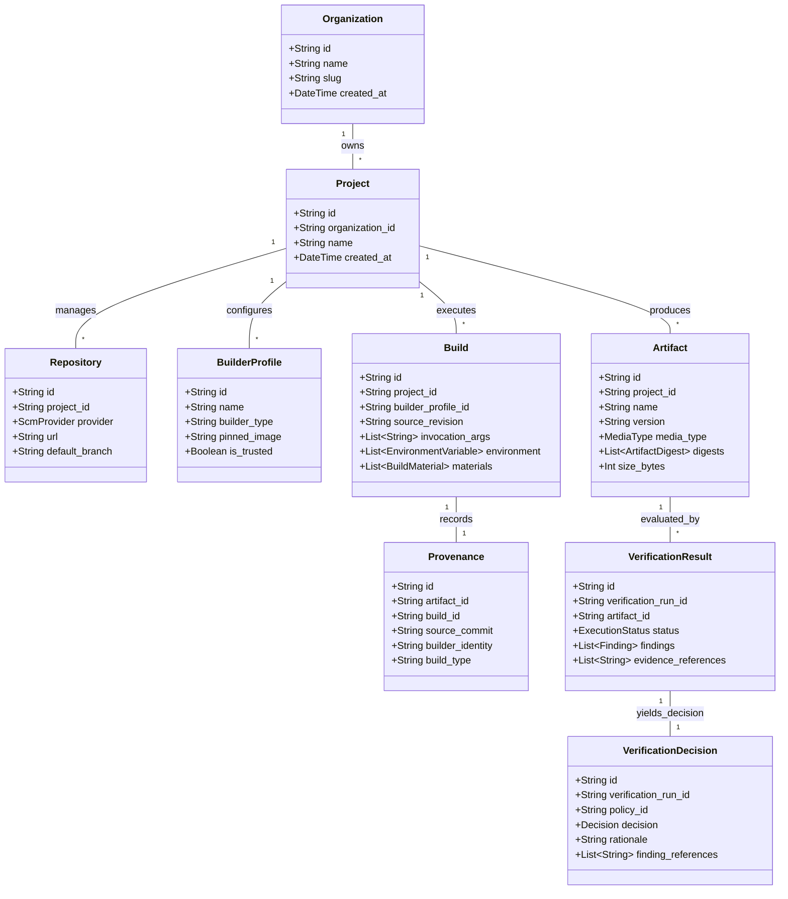

# ProvenanceGuard Domain Model Architecture Specification

This document details the domain entities, value objects, external adapters, declarative stubs, invariants, and validation rules governing the ProvenanceGuard core domain layer (`src/provenanceguard/core/domain/`).

---

## 1. Categorized Public Model Inventory (18 Models)

```
provenanceguard/core/domain/
├── entities.py       # Identity-bearing entities (Organization, Project, Repository, BuilderProfile, Artifact, Build, Provenance, VerificationResult, VerificationDecision)
├── value_objects.py  # Immutable value objects (ArtifactDigest, BuildMaterial, EnvironmentVariable, Attestation, Finding)
├── adapters.py       # External standard representations (SLSAProvenanceV12, InTotoStatement, DSSEEnvelope)
├── stubs.py          # Declarative stubs (Policy, Risk)
├── enums.py          # Strict domain enums
└── exceptions.py     # Domain validation and ingestion rejection exceptions
```

### Categorized Inventory Matrix

| Category | Model Name | Primary Responsibility & Invariants |
|---|---|---|
| **Entities** | `Organization` | Organization entity boundary (`id`, `name`, `slug`). |
| **Entities** | `Project` | Project entity boundary under organization (`id`, `organization_id`, `name`). |
| **Entities** | `Repository` | SCM repository identity reference (`id`, `project_id`, `provider`, `url`, `default_branch`). |
| **Entities** | `BuilderProfile` | Builder profile identity (`id`, `name`, `builder_type`, `pinned_image`, `is_trusted`). |
| **Entities** | `Artifact` | Software artifact entity abstraction (`id`, `project_id`, `name`, `version`, `media_type`, `digests`, `size_bytes`). |
| **Entities** | `Build` | Build execution metadata entity (`id`, `project_id`, `builder_profile_id`, `source_revision`, `invocation_args`, `environment`, `materials`). |
| **Entities** | `Provenance` | Normalized internal build provenance entity (`id`, `artifact_id`, `build_id`, `source_commit`, `builder_identity`, `build_type`). |
| **Entities** | `VerificationResult` | **Execution Evidence Only**. Contains `run_id`, `status`, `findings`, `evidence_references`. **MUST NOT** contain policy decisions or risk scores! |
| **Entities** | `VerificationDecision` | **Policy Gate Outcome**. Owned by Policy Engine (`run_id`, `policy_id`, `decision` [`PASS`, `PASS_WITH_WARNING`, `BLOCK`], `rationale`, `finding_references`). |
| **Value Objects** | `ArtifactDigest` | Immutable cryptographic hash value object (`algorithm`, `value`). Enforces hex format & byte length checks. |
| **Value Objects** | `BuildMaterial` | Immutable dependency reference (`uri`, `digest`, `material_type`). Enforces non-empty URI. |
| **Value Objects** | `EnvironmentVariable` | Immutable build environment variable (`key`, `value`, `is_sensitive`). Rejects raw secret credentials (`AWS_SECRET_ACCESS_KEY`, `PRIVATE_KEY`, `PASSWORD`) without silent mutation. |
| **Value Objects** | `Attestation` | Immutable attestation metadata (`id`, `attestation_type`, `predicate_type`, `subject_digest`, `issuer`). |
| **Value Objects** | `Finding` | Immutable observed discrepancy item (`id`, `severity`, `category`, `subject`, `explanation`, `evidence`, `confidence`, `remediation`). |
| **External Adapters** | `SLSAProvenanceV12` | External representation of SLSA v1.2 predicate (`buildDefinition`, `runDetails`). |
| **External Adapters** | `InTotoStatement` | External representation of in-toto attestation statement (`_type`, `subject`, `predicateType`, `predicate`). |
| **External Adapters** | `DSSEEnvelope` | External representation of DSSE signing envelope (`payload`, `payloadType`, `signatures`). |
| **Declarative Stubs** | `Policy` & `Risk` | Declarative specifications for policy thresholds and risk weighting (without execution engines). |

---

## 2. Fundamental Architectural Invariants

### Invariant 1: Separation of Evidence and Decision
```
Artifact Identity  ≠  Verification Result  ≠  Risk Assessment  ≠  Policy Decision
```
- `VerificationResult` records *what occurred during verification execution* (status, findings, evidence references).
- `VerificationDecision` records *what the policy engine decided to do* (`PASS`, `PASS_WITH_WARNING`, `BLOCK`).

### Invariant 2: Internal Provenance vs External Standards
```
Internal Provenance  ≠  SLSA Representation  ≠  in-toto Representation  ≠  DSSE Envelope
```
- Core verification logic operates on normalized internal `Provenance` domain objects.
- External formats (`SLSAProvenanceV12`, `InTotoStatement`, `DSSEEnvelope`) are isolated external representations.
- Complete standards validation and cryptographic verification are deferred to later phases.

### Invariant 3: Ingestion Rejection vs Policy Block
```
Ingestion Rejection  ≠  Policy BLOCK Decision
```
- Ingestion schema errors raise `IngestionRejectedError` (`PG-1001`, `PG-2001`). Malformed input is rejected at the boundary; it does **NOT** generate a `BLOCK` policy release decision.

### Invariant 4: Strict Domain Layer Independence
```
API  ──►  Application  ──►  Domain  ◄──  Infrastructure (Prohibited)
```
- `src/provenanceguard/core/domain/` depends **ONLY** on Python standard library and Pydantic v2.
- The Domain layer MUST NOT import FastAPI, SQLAlchemy, Redis, Docker, or external network clients.

---

## 3. Entity-Relationship Domain Diagram



---

## 4. Security Bounds & Evidence Handling Policy

1. **No Silent Evidence Mutation**: Input values are strictly validated (Validate → Accept or Validate → Reject). The domain model does not silently transform sensitive values into `"[REDACTED]"`.
2. **Prohibited Credential Rejection**: `EnvironmentVariable` rejects raw secret credential keys (`AWS_SECRET_ACCESS_KEY`, `PRIVATE_KEY`, `PASSWORD`) if submitted as ordinary domain metadata.
3. **Corrected Security Claim**: *"Domain validation reduces malformed-input and parser-abuse risk at the domain boundary by enforcing typed schemas, bounded fields, and structural validation. It does not protect against a compromised runtime or verifier implementation."*
