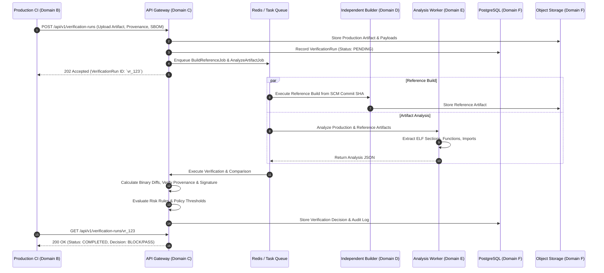
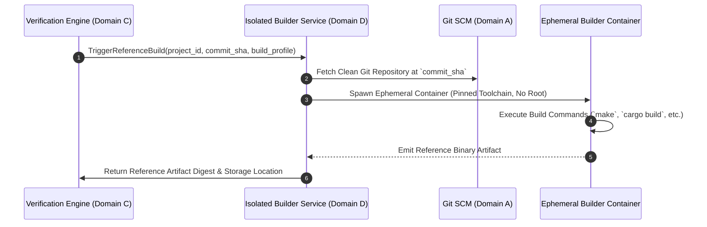
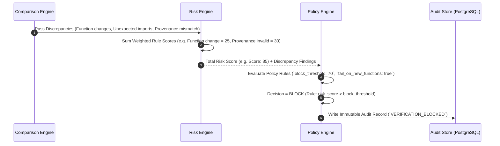
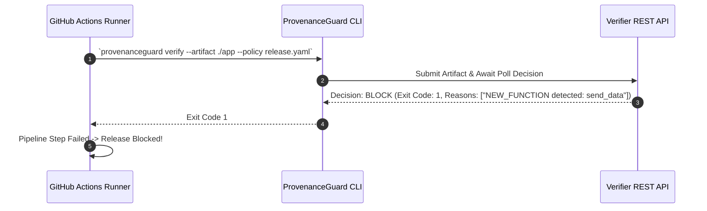
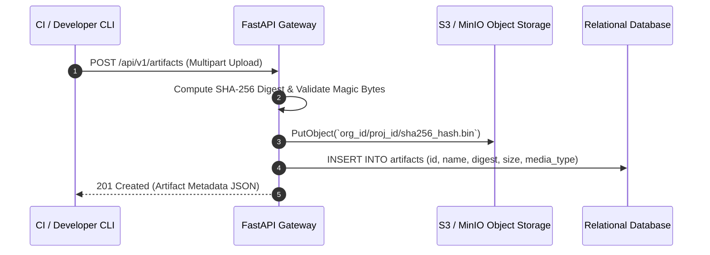
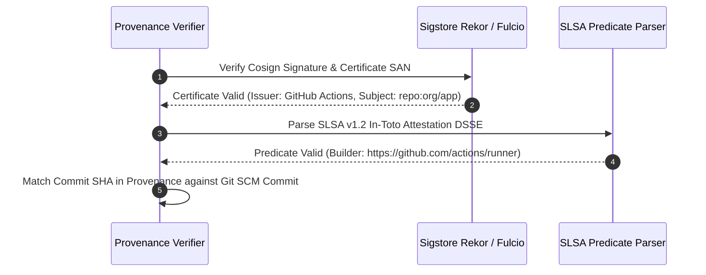

# ProvenanceGuard Sequence Diagrams Specification

This document contains Mermaid sequence diagrams illustrating core interaction flows across ProvenanceGuard trust domains.

---

## 1. Artifact Verification Sequence

---

## 2. Independent Reference Build Sequence

---

## 3. Policy Evaluation Sequence

---

## 4. Verification Failure & CI Release Block Sequence

---

## 5. Artifact Upload Sequence

---

## 6. Signature & Provenance Verification Sequence (Cosign & SLSA)

